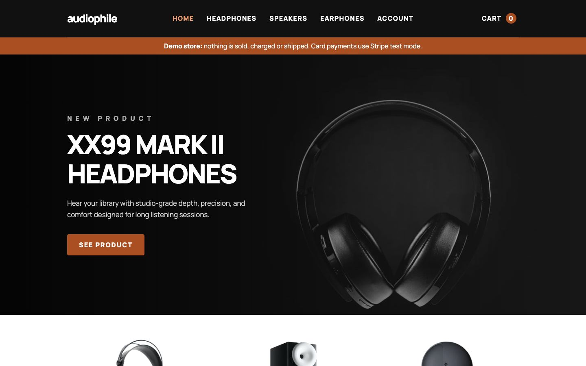

# Frontend Mentor - Audiophile e-commerce website solution

This is a solution to the [Audiophile e-commerce website challenge on Frontend Mentor](https://www.frontendmentor.io/challenges/audiophile-ecommerce-website-C8cuSd_wx). I built a responsive demo store for browsing audio products, managing a cart and completing a test checkout.

## Table of contents

- [Overview](#overview)
  - [The challenge](#the-challenge)
  - [Screenshot](#screenshot)
  - [Links](#links)
- [My process](#my-process)
  - [Built with](#built-with)
  - [What I learned](#what-i-learned)
  - [Continued development](#continued-development)
- [Run it locally](#run-it-locally)
- [Author](#author)

## Overview

### The challenge

Users should be able to:

- Browse headphones, speakers and earphones, and open each product's details.
- Use the layout and navigation on mobile, tablet and desktop screens.
- Add products to the cart, change quantities, remove items or clear the cart.
- Keep the cart after refreshing the page in the same browser.
- Complete the checkout form and see errors for missing or invalid details.
- Review product totals, $50 shipping and the brief's included 20% VAT.
- See an order confirmation with a summary of their purchase.

### Screenshot



### Links

- Solution URL: [My Frontend Mentor solution](https://www.frontendmentor.io/solutions/audiophile-e-commerce-with-nextjs-typescript-and-tailwind-5ISbaNXNvM)
- Live Site URL: [Audiophile demo store](https://audiophile.royeradames.com)

## My process

### Built with

- Next.js App Router and React
- TypeScript
- Custom CSS, Grid and Flexbox
- TanStack Form and Zod for checkout validation
- PostgreSQL on Neon for stored orders
- Stripe Checkout and Payment Element in test mode
- vinext and Vite for the Sites build
- Node.js test runner, PGlite and Playwright

### What I learned

I calculate stored order and payment totals on the server from validated catalog items. The browser displays a total, but it cannot set the amount charged. Zod checks product IDs and quantities, and `priceCart` looks up each price in the catalog. Unknown products and duplicate items are rejected.

The brief's 20% VAT conflicted with the Dominican Republic's 18% ITBIS. I chose the brief, and PR 12 switched the calculation. VAT is shown as included in product prices, so the grand total adds only shipping. Older orders keep their stored totals. I learned to record the owner's choice and default when two rules disagree.

I save the server order before starting payment. A request key makes a repeated submission return the same order, and payment confirmation checks the stored amount. Placing an order and paying for it are separate steps. The demo checkout validates name, email, phone and address in the browser without sending those details to the store server.

### Continued development

- I need to update the older browser-only order and production-checkout notes in `docs/payment-testing.md` to match the current server-backed demo.

## Run it locally

I use Node.js 22.13 or newer.

```bash
npm install
cp .env.example .env.local
cp .dev.vars.example .dev.vars
npm run dev
```

The local payment guide uses `http://localhost:3000`. For card testing, I put the same Stripe `sk_test_` and `pk_test_` values in both copied files. The examples also list the webhook secret and optional `STAFF_PASSWORD`. Keep both local files out of Git. `/orders` is open on localhost without a password; set `STAFF_PASSWORD` before exposing that queue publicly.

```bash
npm test
npm run lint
npm run build:vercel
```

`npm test` runs unit and in-memory PostgreSQL checks, both build targets, HTML checks and a browser layout check across 15 routes and 22 widths. It needs Google Chrome. Native Next.js builds target Vercel; vinext builds target the private Sites fallback.

Optional checks from the existing setup:

```bash
npm run test:journey
npm run test:hosted
node tests/checkout-cancel.browser.mjs
```

Run `test:journey` after `build:vercel`; it starts local HTTPS services and needs Stripe test keys. `test:hosted` needs the protected Preview URL, bypass token and test secrets. The cancellation check needs a native production server at `http://127.0.0.1:4346`, Chrome and Playwright. `AUDIOPHILE_URL` selects another localhost server, and `PLAYWRIGHT_MODULE` can point to an existing Playwright `index.mjs`. Results go to ignored `outputs/`.

For local webhooks:

```bash
stripe listen --forward-to localhost:3000/api/stripe/webhook
```

Database migrations are in `migrations/`. Review the plan before applying it to one named Neon database:

```bash
npm run db:plan
vercel env run -e preview -- node scripts/migrate.mjs --neon-project=<NEON_PROJECT_ID> --reviewed-sha256=<combined hash>
```

Run that migration command from a checkout without `.env.local`, which can override the selected Vercel environment. Preview and Development share a Neon project; Production uses its own. The demo-store expand/contract migration requires applying through `0004_demo_store_expand.sql` before deploying, then applying the remaining files. Roll forward after the expand step.

This is a demo. Nothing is sold, charged for real or shipped. I use fictional checkout details and Stripe test cards; live Stripe keys are refused. Do not send money to the mock bank or Zelle details. Confirmation stays unpaid until Stripe reports a test payment or a transfer is marked paid by hand. AZUL affiliation and live merchant setup remain unfinished human steps listed on `/payments`. The [payment-testing guide](./docs/payment-testing.md) has the click-through instructions, though some older notes need the update listed above.

The cart and payee mocks persist in the current browser. Vercel stores orders, items, totals and payment status in Neon; the Sites fallback keeps orders in the browser. Unpaid orders are purged after seven days when open card attempts can be safely cancelled. Production needs `CRON_SECRET` and `RATE_LIMIT_SECRET`; Preview and Development are not purged. Dropped columns remain in Neon's point-in-time history until its retention window passes.

I keep text at least 16 px, which changes some spacing from the supplied design. The six fictional products, imagery and seed copy come from the challenge assets. See [the third-party asset licence](./THIRD_PARTY_ASSETS_LICENSE.md).

## Author

- Website - [Royer Adames](https://royeradames.com)
- Frontend Mentor - [@royeradames](https://www.frontendmentor.io/profile/royeradames)
